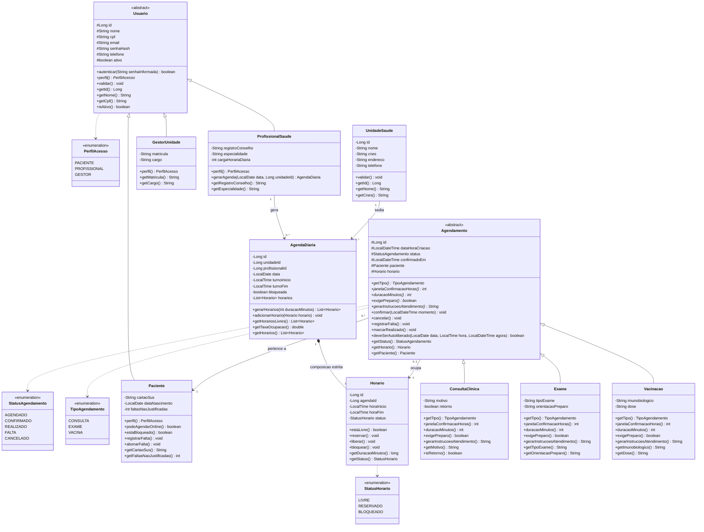
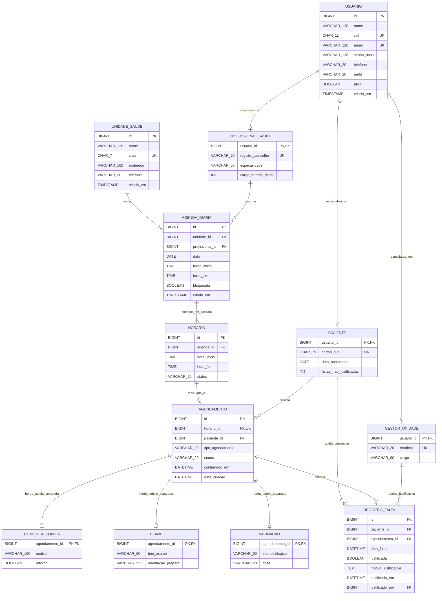

# VagaCerta: Sistema de Agendamento e Combate ao Absenteísmo em Unidades Básicas de Saúde

## Identificação Acadêmica e Autoria

- **Instituição:** Centro Universitário de Maringá (UniCesumar)
- **Curso:** Engenharia de Software
- **Ano Letivo:** 2026
- **Autores:**
  - Gustavo Antunes da Silva (RA: 25000468-2)
  - Jonatas Marques da Silva (RA: 25006769-2)
  - Rafael Garcia Ribeiro (RA: 25000457-2)

---

## 1. Contexto, Problema e Alinhamento aos Objetivos de Desenvolvimento Sustentável (ODS)

Na gestão da atenção primária e especializada do Sistema Único de Saúde (SUS), o absenteísmo de pacientes em consultas e exames previamente agendados constitui um dos principais gargalos de eficiência assistencial. Registros do primeiro trimestre de 2026 no município de Piracicaba (SP) evidenciaram 57.332 faltas em um total de 248.143 atendimentos programados, o que representa um índice de absenteísmo de 23,1% na rede geral e 26,7% na Atenção Básica. Em 2025, o volume consolidado de ausências não justificadas naquele município atingiu 310.365 ocorrências, superando a própria fila de espera local (225.771 pessoas). Comportamento análogo é documentado regionalmente, ultrapassando 40% na atenção especializada do ABC Paulista e atingindo 19,2% em estudos em Unidades Básicas de Saúde (UBS) em Pelotas (RS).

O cerne do problema reside no desperdício da capacidade instalada decorrente de falha operacional: a ausência de confirmação prévia e a inexistência de rotinas automáticas de liberação impedem que vagas reservadas para pacientes desistentes sejam repassadas em tempo hábil para pessoas que aguardam atendimento. A vaga caduca no sistema no momento em que o turno é encerrado, enquanto a fila reprimida continua crescendo.

O projeto VagaCerta fundamenta-se nos seguintes compromissos globais estabelecidos pela Organização das Nações Unidas:

- **ODS 3 (Saúde e Bem-Estar) - Meta 3.8:** Atingir a cobertura universal de saúde e o acesso a serviços essenciais de qualidade. O reaproveitamento dinâmico de vagas ociosas maximiza a capacidade operacional instalada sem exigir desembolso financeiro para ampliação de instalações físicas ou contratação de novos quadros médicos.
- **ODS 3 (Saúde e Bem-Estar) - Meta 3.4:** Reduzir a mortalidade prematura por doenças não transmissíveis. Pacientes com patologias crônicas (hipertensão arterial, diabetes mellitus) exigem acompanhamento periódico ininterrupto, sendo os mais prejudicados pelas falhas de continuidade na agenda assistencial.

---

## 2. Regras de Negócio (RN)

- **RN01 - Exclusividade de Horário:** Cada horário da grade admite apenas um agendamento com status ativo. No instante da reserva, o horário transita imediatamente do estado LIVRE para RESERVADO, saindo da grade disponível. Em caso de cancelamento voluntário ou descarte automático, o horário retorna imediatamente para o estado LIVRE, ficando apto para nova reserva.
- **RN02 - Janela Diferenciada de Confirmação Prévia e Autoliberação:** A confirmação de presença é obrigatória dentro de janelas temporais dinâmicas conforme a complexidade do procedimento:
  - Consulta Clínica: confirmação obrigatória até 24 horas antes do horário marcado.
  - Exame Diagnóstico: confirmação obrigatória até 48 horas antes, devido à necessidade de preparo prévio (jejum, interrupção de fármacos) e à perda irreversível de reagentes e insumos laboratoriais.
  - Vacinação: procedimento isento de confirmação prévia (janela de 0 horas), dispensando descarte por timeout.
  - Regra de Descarte: A não confirmação de agendamentos de consulta ou exame dentro da janela estipulada acarreta o cancelamento automático do agendamento e a devolução imediata do horário à fila pública.
- **RN03 - Restrição por Reincidência de Absenteísmo:** O acúmulo de três faltas não justificadas em um intervalo de seis meses bloqueia a faculdade de agendamento remoto pelo próprio paciente (`podeAgendarOnline() == false`). O restabelecimento da prerrogativa de agendamento online demanda o comparecimento presencial do cidadão ao setor de acolhimento da UBS para justificativa com atestado validado por um Gestor da Unidade.
- **RN04 - Geração Dinâmica da Grade:** Os horários diários de atendimento são fracionados matematicamente com base no turno do profissional e na duração padrão tabelada de cada especialidade:
  - Consulta Clínica: duração padrão de 20 minutos.
  - Exame Diagnóstico: duração padrão de 30 minutos.
  - Vacinação: duração padrão de 5 minutos.

---

## 3. Justificativa Arquitetural e Tecnologias Adotadas

A solução adota o padrão arquitetural em camadas combinado ao modelo MVC (Model-View-Controller) com DAO (Data Access Object), implementado com as seguintes decisões de engenharia:

- **Java 17 e Pure JDBC (java.sql.*):** Utilização da biblioteca padrão de conectividade JDBC pura, sem a introdução de frameworks utilitários ou Object-Relational Mapping (ORM) como Hibernate, Spring Data ou Spring Boot. Essa decisão garante total controle transacional (gerenciamento explícito de `commit` e `rollback`), elimina o overhead de inicialização de containers e viabiliza a execução determinística em ambientes com restrição de recursos computacionais.
- **Persistência Relacional (MySQL 8 / SQLite):** O modelo físico implementa normalização rigorosa e integridade referencial com chaves estrangeiras ativas (`ON DELETE CASCADE` para relações de composição estrita). A integridade concorrente da regra RN01 é garantida no nível físico do banco de dados por meio da restrição `UNIQUE (horario_id)` na tabela `agendamento`. A fábrica de conexões (`ConnectionFactory`) permite a alternância transparente entre MySQL 8 e SQLite via configuração de variáveis de ambiente.
- **Pilares da Programação Orientada a Objetos (POO):**
  - **Herança Legítima:** Estruturada em dois eixos conceituais sem subclasses artificiais: a hierarquia de atores com a classe base abstrata `Usuario` especializando-se em `Paciente`, `ProfissionalSaude` e `GestorUnidade`; e a hierarquia clínica com a classe base abstrata `Agendamento` especializando-se em `ConsultaClinica`, `Exame` e `Vacinacao`.
  - **Composição Estrita:** A classe `AgendaDiaria` atua como compositora contendo uma lista de instâncias de `Horario` (relação 1:N). A composição é adotada em detrimento da herança porque um `Horario` não é uma `AgendaDiaria` (violaria o Princípio de Substituição de Liskov caso herdasse dela), mas sim parte constituinte e inseparável do ciclo de vida da agenda de um turno.
  - **Polimorfismo:** Métodos abstratos da classe `Agendamento` (`janelaConfirmacaoHoras()`, `duracaoMinutos()`, `exigePreparo()`, `gerarInstrucoesAtendimento()` e `deveSerAutoliberado()`) são sobrescritos com comportamentos distintos por cada procedimento. O motor de autoliberação varre listas polimórficas de agendamentos pendentes aplicando a regra de descarte temporal sem acoplamento a estruturas condicionais extensas (`if/else` ou `switch`).

---

## 4. Diagrama de Classes UML (Mermaid.js)



---

## 5. Diagrama Entidade-Relacionamento (DER) em Modelo Físico (Mermaid.js)



---

## 6. Estrutura de Diretórios e Pacotes do Código-Fonte

```
/
├── java-backend/
│   ├── pom.xml                                  # Configuração de build Maven e dependências
│   ├── schema.sql                               # Script DDL oficial para MySQL 8
│   ├── lib/                                     # Dependências JAR autocontidas (JDBC e JUnit)
│   │   ├── sqlite-jdbc-3.45.1.0.jar
│   │   ├── mysql-connector-j-8.3.0.jar
│   │   ├── junit-jupiter-api-5.10.2.jar
│   │   ├── junit-jupiter-engine-5.10.2.jar
│   │   └── junit-platform-console-standalone-1.10.2.jar
│   └── src/
│       ├── main/java/br/com/vagacerta/
│       │   ├── Main.java                        # Classe executável principal
│       │   ├── model/
│       │   │   ├── enums/
│       │   │   │   ├── PerfilAcesso.java
│       │   │   │   ├── StatusHorario.java
│       │   │   │   ├── StatusAgendamento.java
│       │   │   │   └── TipoAgendamento.java
│       │   │   ├── usuario/
│       │   │   │   ├── Usuario.java             # Classe base abstrata
│       │   │   │   ├── Paciente.java            # Herança e validação de RN03
│       │   │   │   ├── ProfissionalSaude.java   # Herança e método gerarAgenda
│       │   │   │   └── GestorUnidade.java       # Herança de controle gestor
│       │   │   ├── unidade/
│       │   │   │   └── UnidadeSaude.java
│       │   │   ├── agenda/
│       │   │   │   ├── Horario.java
│       │   │   │   └── AgendaDiaria.java        # Composição estrita e RN04
│       │   │   └── agendamento/
│       │   │       ├── Agendamento.java         # Base abstrata polimórfica
│       │   │       ├── ConsultaClinica.java     # Polimorfismo: 24h / 20 min
│       │   │       ├── Exame.java               # Polimorfismo: 48h / 30 min / preparo
│       │   │       └── Vacinacao.java           # Polimorfismo: 0h / 5 min / isenta
│       │   ├── dao/
│       │   │   ├── ConnectionFactory.java       # Conexões JDBC puras e rotina DDL
│       │   │   ├── UsuarioDAO.java              # CRUD relacional da hierarquia Usuario
│       │   │   ├── UnidadeSaudeDAO.java         # CRUD de Unidades Básicas de Saúde
│       │   │   ├── AgendaDiariaDAO.java         # CRUD com persistência atômica da composição
│       │   │   └── AgendamentoDAO.java          # CRUD com restrição UNIQUE e lock RN01
│       │   └── service/
│       │       ├── AgendamentoService.java      # RN01, RN02 (autoliberação), RN03 e RN04
│       │       ├── AbsenteismoService.java      # Registro de faltas e acolhimento presencial
│       │       └── RelatoriosService.java       # Indicadores e Business Intelligence (F6)
│       └── test/java/br/com/vagacerta/test/
│           └── VagaCertaTest.java               # Suíte de testes unitários em JUnit 5
```

---

## 7. Instruções de Compilação, Testes e Execução

### Requisitos de Ambiente
- Java Development Kit (JDK) versão 17 ou superior instalada.
- Ambiente de terminal (Linux/macOS Bash ou Windows CMD/PowerShell).

### Compilação do Projeto
Para compilar todas as classes do modelo, DAO, serviços e testes unitários em um diretório binário isolado:

```bash
cd java-backend
mkdir -p bin
javac -cp "lib/*" -d bin $(find src -name "*.java")
```

### Execução da Suíte de Testes Unitários em JUnit 5
A suíte `VagaCertaTest` valida em nível unitário a herança de usuários, a parametrização dinâmica de grade por procedimento (RN04), o cálculo polimórfico de janelas de descarte e autoliberação (RN02) e o bloqueio automático por reincidência de faltas com posterior desbloqueio por abono presencial (RN03):

```bash
cd java-backend
java -cp "bin:lib/*" org.junit.platform.console.ConsoleLauncher --scan-class-path --class-path "bin"
```

### Execução da Demonstração Completa Ponta a Ponta
A classe `Main` realiza a execução automatizada de todo o ciclo de vida do software: inicialização das tabelas relacionais com chaves estrangeiras, cadastro de UBS e atores via herança, geração dinâmica de horários via composição (RN04), efetivação de agendamentos polimórficos com lock de horário (RN01), teste de tentativa de reserva concorrente rejeitada (RN01), simulação de decurso de prazo temporal com descarte automático de vagas não confirmadas e retorno imediato ao estado livre (RN02), bloqueio de paciente reincidente com posterior acolhimento presencial por gestor (RN03) e emissão de relatório consolidado de Business Intelligence:

```bash
cd java-backend
java -cp "bin:lib/*" br.com.vagacerta.Main
```

### Execução em Modo Interativo (Terminal CLI)
Para operar o sistema em modo de terminal interativo:

```bash
cd java-backend
java -cp "bin:lib/*" br.com.vagacerta.Main --interactive
```

---

## 8. Considerações Finais de Conformidade

A implementação entrega integralmente todos os requisitos especificados para a avaliação bimestral de Engenharia de Software da UniCesumar:
- Adoção estrita de Java 17 com Pure JDBC e arquitetura em camadas sem dependência de frameworks invasivos.
- Mapeamento objeto-relacional estruturado em tabelas separadas por herança (PF) com integridade referencial.
- Aplicação comprovada e testada dos três pilares da Programação Orientada a Objetos: herança sem duplicação de atributos, composição com ciclo de vida dependente e polimorfismo dinâmico nos serviços de controle de absenteísmo e autoliberação de vagas.

