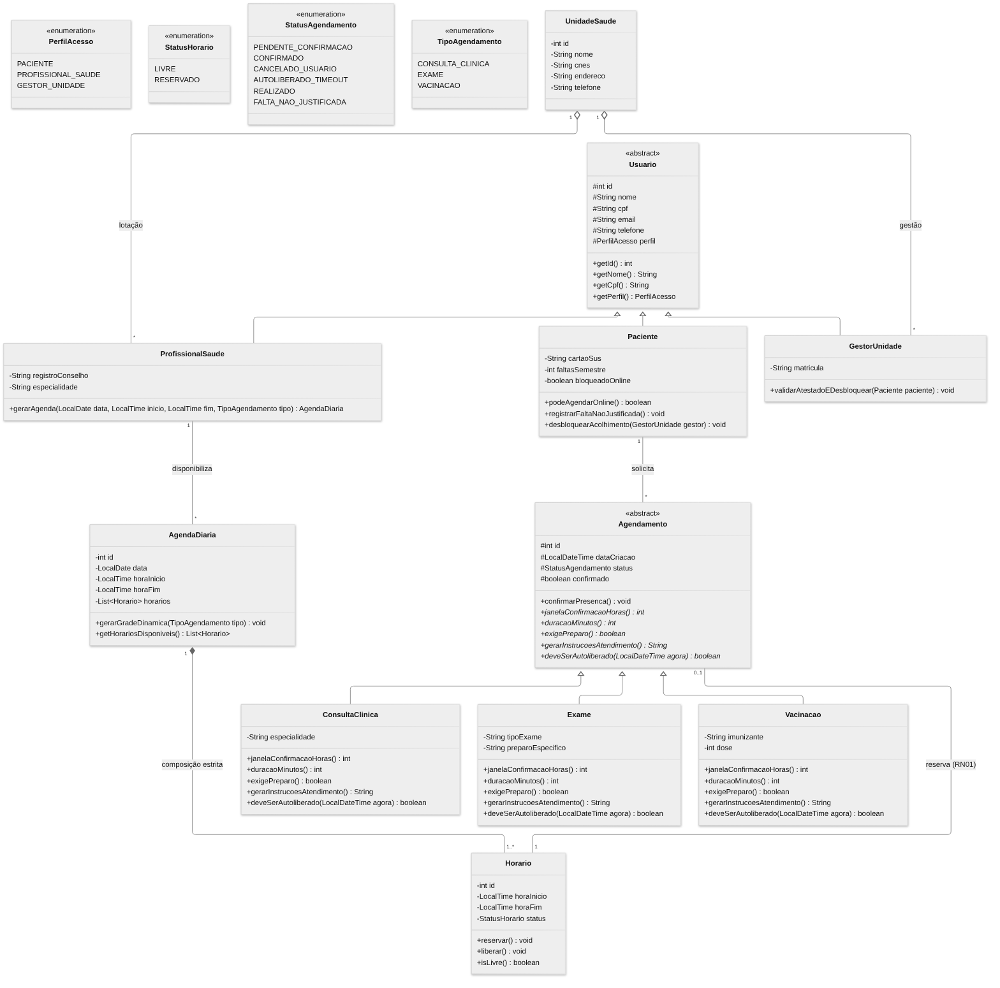
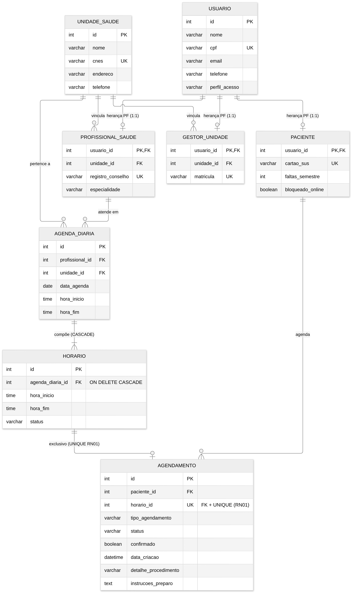

# VagaCerta: Sistema de Agendamento e Combate ao Absenteísmo em Unidades Básicas de Saúde

## Identificação Acadêmica e Autoria

* **Instituição:** Centro Universitário de Maringá (UniCesumar)

* **Curso:** Engenharia de Software

* **Autores:**

  * Gustavo Antunes da Silva (RA: 25000468-2)

  * Jonatas Marques da Silva (RA: 25006769-2)

  * Rafael Garcia Ribeiro (RA: 25000457-2)

## 1. Contexto, Problema e Alinhamento aos Objetivos de Desenvolvimento Sustentável (ODS)

Na gestão da atenção primária e especializada do Sistema Único de Saúde (SUS), o absenteísmo de pacientes em consultas e exames previamente agendados constitui um dos principais gargalos de eficiência assistencial. Registros do primeiro trimestre de 2026 no município de Piracicaba (SP) evidenciaram 57.332 faltas em um total de 248.143 atendimentos programados, o que representa um índice de absenteísmo de 23,1% na rede geral e 26,7% na Atenção Básica. Em 2025, o volume consolidado de ausências não justificadas naquele município atingiu 310.365 ocorrências, superando a própria fila de espera local (225.771 pessoas). Comportamento análogo é documentado regionalmente, ultrapassando 40% na atenção especializada do ABC Paulista e atingindo 19,2% em estudos em Unidades Básicas de Saúde (UBS) em Pelotas (RS).

O cerne do problema reside no desperdício da capacidade instalada decorrente de falha operacional: a ausência de confirmação prévia e a inexistência de rotinas automáticas de liberação impedem que vagas reservadas para pacientes desistentes sejam repassadas em tempo hábil para pessoas que aguardam atendimento. A vaga caduca no sistema no momento em que o turno é encerrado, enquanto a fila reprimida continua crescendo.

O projeto **VagaCerta** fundamenta-se nos seguintes compromissos globais estabelecidos pela Organização das Nações Unidas:

* **ODS 3 (Saúde e Bem-Estar) - Meta 3.8:** Atingir a cobertura universal de saúde e o acesso a serviços essenciais de qualidade. O reaproveitamento dinâmico de vagas ociosas maximiza a capacidade operacional instalada sem exigir desembolso financeiro para ampliação de instalações físicas ou contratação de novos quadros médicos.

* **ODS 3 (Saúde e Bem-Estar) - Meta 3.4:** Reduzir a mortalidade prematura por doenças não transmissíveis. Pacientes com patologias crônicas (hipertensão arterial, diabetes mellitus) exigem acompanhamento periódico ininterrupto, sendo os mais prejudicados pelas falhas de continuidade na agenda assistencial.

## 2. Regras de Negócio (RN)

* **RN01 - Exclusividade de Horário:** Cada horário da grade admite apenas um agendamento com status ativo. No instante da reserva, o horário transita imediatamente do estado `LIVRE` para `RESERVADO`, saindo da grade disponível. Em caso de cancelamento voluntário ou descarte automático, o horário retorna imediatamente para o estado `LIVRE`, ficando apto para nova reserva.

* **RN02 - Janela Diferenciada de Confirmação Prévia e Autoliberação:** A confirmação de presença é obrigatória dentro de janelas temporais dinâmicas conforme a complexidade do procedimento:

  * **Consulta Clínica:** confirmação obrigatória até **24 horas** antes do horário marcado.

  * **Exame Diagnóstico:** confirmação obrigatória até **48 horas** antes, devido à necessidade de preparo prévio (jejum, interrupção de fármacos) e à perda irreversível de reagentes e insumos laboratoriais.

  * **Vacinação:** procedimento isento de confirmação prévia (janela de **0 horas**), dispensando descarte por timeout.

  * **Regra de Descarte:** A não confirmação de agendamentos de consulta ou exame dentro da janela estipulada acarreta o cancelamento automático do agendamento e a devolução imediata do horário à fila pública.

* **RN03 - Restrição por Reincidência de Absenteísmo:** O acúmulo de três faltas não justificadas em um intervalo de seis meses bloqueia a faculdade de agendamento remoto pelo próprio paciente (`podeAgendarOnline() == false`). O restabelecimento da prerrogativa de agendamento online demanda o comparecimento presencial do cidadão ao setor de acolhimento da UBS para justificativa com atestado validado por um Gestor da Unidade.

* **RN04 - Geração Dinâmica da Grade:** Os horários diários de atendimento são fracionados matematicamente com base no turno do profissional e na duração padrão tabelada de cada especialidade:

  * **Consulta Clínica:** duração padrão de **20 minutos**.

  * **Exame Diagnóstico:** duração padrão de **30 minutos**.

  * **Vacinação:** duração padrão de **5 minutos**.

## 3. Justificativa Arquitetural e Tecnologias Adotadas

A solução adota o padrão arquitetural em camadas combinado ao modelo **MVC (Model-View-Controller)** com **DAO (Data Access Object)**, implementado com as seguintes decisões de engenharia:

* **Java 17 e Pure JDBC (`java.sql.*`):** Utilização da biblioteca padrão de conectividade JDBC pura, sem a introdução de frameworks utilitários ou Object-Relational Mapping (ORM) como Hibernate, Spring Data ou Spring Boot. Essa decisão garante total controle transacional (gerenciamento explícito de `commit` e `rollback`), elimina o overhead de inicialização de containers e viabiliza a execução determinística em ambientes com restrição de recursos computacionais.

* **Persistência Relacional (MySQL 8 / SQLite):** O modelo físico implementa normalização rigorosa e integridade referencial com chaves estrangeiras ativas (`ON DELETE CASCADE` para relações de composição estrita). A integridade concorrente da regra RN01 é garantida no nível físico do banco de dados por meio da restrição `UNIQUE (horario_id)` na tabela `agendamento`. A fábrica de conexões (`ConnectionFactory`) permite a alternância transparente entre MySQL 8 e SQLite via configuração de variáveis de ambiente.

* **Pilares da Programação Orientada a Objetos (POO):**

  * **Herança Legítima:** Estruturada em dois eixos conceituais sem subclasses artificiais: a hierarquia de atores com a classe base abstrata `Usuario` especializando-se em `Paciente`, `ProfissionalSaude` e `GestorUnidade`; e a hierarquia clínica com a classe base abstrata `Agendamento` especializando-se em `ConsultaClinica`, `Exame` e `Vacinacao`.

  * **Composição Estrita:** A classe `AgendaDiaria` atua como compositora contendo uma lista de instâncias de `Horario` (relação `1:N`). A composição é adotada em detrimento da herança porque um `Horario` não é uma `AgendaDiaria` (violaria o Princípio de Substituição de Liskov caso herdasse dela), mas sim parte constituinte e inseparável do ciclo de vida da agenda de um turno.

  * **Polimorfismo:** Métodos abstratos da classe `Agendamento` (`janelaConfirmacaoHoras()`, `duracaoMinutos()`, `exigePreparo()`, `gerarInstrucoesAtendimento()` e `deveSerAutoliberado()`) são sobrescritos com comportamentos distintos por cada procedimento. O motor de autoliberação varre listas polimórficas de agendamentos pendentes aplicando a regra de descarte temporal sem acoplamento a estruturas condicionais extensas (`if/else` ou `switch`).

## 4. Diagrama de Classes UML



*Legenda: triângulo vazado = herança; losango preenchido = composição; losango vazado = agregação; itálico = método abstrato; `+` público, `-` privado, `#` protegido. Arquivos editáveis: [draw.io](docs/diagramas/VagaCerta_Diagrama_Classes_UML.drawio) e [código Mermaid](docs/diagramas/fonte_diagrama_classes_UML.mmd).*

## 5. Diagrama Entidade-Relacionamento (DER) em Modelo Físico



*Legenda: PK = chave primária; FK = chave estrangeira; UK = chave única. Notação pé de galinha: `||` exatamente um, `o|` zero ou um, `o{` zero ou muitos, `|{` um ou muitos. Arquivos editáveis: [draw.io](docs/diagramas/VagaCerta_DER.drawio) e [código Mermaid](docs/diagramas/fonte_diagrama_DER.mmd).*

> Nota: o esquema implementado em `database/01_schema.sql` tem 13 tabelas (inclui as tabelas das especializações de agendamento, `registro_falta` e `liberacao_vaga`). As diferenças em relação a este DER estão descritas em `docs/AUDITORIA_CONFORMIDADE.md`.

## 6. Estrutura de Diretórios e Pacotes do Código-Fonte

```
vagacerta/
├── backend/                          # API e regras de negócio (Java 17, JDBC puro)
│   ├── lib/                          # JARs externos autocontidos (JDBC e JUnit)
│   │   ├── sqlite-jdbc-3.45.1.0.jar
│   │   ├── mysql-connector-j-8.3.0.jar
│   │   ├── junit-jupiter-api-5.10.2.jar
│   │   ├── junit-jupiter-engine-5.10.2.jar
│   │   ├── junit-platform-console-standalone-1.10.2.jar
│   │   └── ... (demais dependências do JUnit e do SLF4J)
│   └── src/
│       ├── Main.java                 # Classe executável principal (demo, --interactive, --api, --db-check)
│       ├── model/                    # Entidades de domínio
│       │   ├── RegraNegocioException.java
│       │   ├── enums/                # PerfilAcesso, StatusHorario, StatusAgendamento, TipoAgendamento
│       │   ├── usuario/              # Usuario (abstrata), Paciente, ProfissionalSaude, GestorUnidade
│       │   ├── unidade/              # UnidadeSaude
│       │   ├── agenda/               # AgendaDiaria (composição e RN04), Horario, HorarioDisponivel
│       │   ├── agendamento/          # Agendamento (abstrata), ConsultaClinica, Exame, Vacinacao,
│       │   │                         # RegistroFalta, LiberacaoVaga
│       │   └── relatorio/            # RelatorioBI
│       ├── dao/                      # Acesso ao banco e queries SQL (JDBC)
│       │   ├── BaseDAO.java, Transacao.java, SqlFunction.java, PersistenciaException.java
│       │   ├── UsuarioDAO.java, UnidadeSaudeDAO.java, AgendaDiariaDAO.java
│       │   ├── AgendamentoDAO.java, RegistroFaltaDAO.java, LiberacaoVagaDAO.java
│       │   └── RelatorioDAO.java
│       ├── service/                  # Regras de negócio e validações
│       │   ├── UsuarioService.java        # Cadastro unificado e validações
│       │   ├── AgendamentoService.java    # RN01, RN02 (autoliberação), RN03 e RN04
│       │   ├── AbsenteismoService.java    # Registro de faltas e acolhimento presencial
│       │   └── RelatoriosService.java     # Indicadores e Business Intelligence
│       ├── api/                      # Endpoints HTTP (ApiServer) e serialização JSON (Json)
│       ├── util/                     # ConnectionFactory, StatusConexao, SenhaUtil, Validador, Sql
│       ├── view/                     # DemoCompleta e CliInterativa (terminal)
│       └── test/                     # VagaCertaTest.java (suíte JUnit 5)
├── frontend/                         # Interface web (React + TypeScript + Vite)
│   ├── public/                       # Arquivos estáticos
│   ├── src/
│   │   ├── components/               # Componentes reutilizáveis (ui.tsx, Senha.tsx)
│   │   ├── pages/                    # Telas: Paciente, Profissional e Gestor
│   │   ├── services/                 # Requisições HTTP para o backend (api.ts)
│   │   ├── types/                    # Interfaces TypeScript espelhando os models
│   │   ├── App.tsx                   # Login, rotas e layout principal
│   │   ├── main.tsx                  # Ponto de entrada da aplicação
│   │   └── hooks.ts, format.ts, index.css
│   ├── index.html
│   ├── package.json, tsconfig.json, vite.config.ts
├── database/                         # Scripts SQL versionados
│   ├── 01_schema.sql                 # Criação de tabelas, chaves e constraints (MySQL 8)
│   ├── 02_seed.sql                   # Inserts iniciais para popular e testar o sistema (MySQL 8)
│   ├── 01_schema_sqlite.sql          # Mesmo modelo físico para SQLite (banco padrão)
│   └── 02_seed_sqlite.sql            # Mesmos seeds para SQLite
├── docs/                             # PDFs da AEP, documentação técnica, auditoria e diagramas/ (UML e DER)
└── README.md                         # Passo a passo para subir banco, back e front
```

## 7. Instruções de Compilação, Testes e Execução

### Requisitos de Ambiente

* **Java Development Kit (JDK)** versão **17** ou superior.

* **Node.js 18** ou superior (somente para o frontend).

* Terminal: Linux/macOS (Bash) ou Windows (CMD/PowerShell).

> **Windows:** em todos os comandos Java abaixo, troque `:` por `;` no classpath (`"bin;lib/*"`). Rodando a partir de `backend/`, os scripts do banco são encontrados automaticamente em `../database`.

### 7.1 Compilação do backend

```bash
cd backend
mkdir -p bin
javac -encoding UTF-8 -cp "lib/*" -d bin $(find src -name "*.java")
```

No Windows (CMD), liste os fontes em um arquivo e compile:

```
cd backend
mkdir bin
dir /s /b src\*.java > fontes.txt
javac -encoding UTF-8 -cp "lib/*" -d bin @fontes.txt
```

### 7.2 Banco de dados

**SQLite (padrão, sem configuração):** na primeira execução é criado o arquivo local `vagacerta.db`, a partir de `database/01_schema_sqlite.sql` e `database/02_seed_sqlite.sql`.

**MySQL 8 (opcional):** crie o banco rodando `database/01_schema.sql` e depois `database/02_seed.sql` no MySQL Workbench (ou deixe o sistema criar automaticamente na primeira execução) e informe a conexão por variáveis de ambiente:

```bash
export VAGACERTA_JDBC_URL="jdbc:mysql://localhost:3306/vagacerta_db?createDatabaseIfNotExist=true&useSSL=false&allowPublicKeyRetrieval=true"
export VAGACERTA_DB_USER=root
export VAGACERTA_DB_PASSWORD=sua_senha
```

No Windows (CMD), use `set "VAGACERTA_JDBC_URL=..."`, `set VAGACERTA_DB_USER=root` e `set VAGACERTA_DB_PASSWORD=sua_senha`.

**Testar a conexão e validar as 13 tabelas:**

```bash
cd backend
java -cp "bin:lib/*" Main --db-check
```

### 7.3 Suíte de testes unitários (JUnit 5)

A suíte `VagaCertaTest` valida a herança de usuários, a grade dinâmica por procedimento (RN04), as janelas de descarte e autoliberação (RN02), a exclusividade de horário com concorrência (RN01) e o bloqueio por reincidência de faltas (RN03):

```bash
cd backend
java -cp "bin:lib/*" org.junit.platform.console.ConsoleLauncher execute --scan-class-path --class-path bin
```

### 7.4 Demonstração completa ponta a ponta

A classe `Main` executa o ciclo de vida completo: criação das tabelas, cadastro de UBS e atores, geração da grade (RN04), agendamentos polimórficos (RN01), tentativa concorrente rejeitada, autoliberação por prazo vencido (RN02), bloqueio e acolhimento presencial (RN03) e relatório de Business Intelligence:

```bash
cd backend
java -cp "bin:lib/*" Main
```

### 7.5 Modo interativo (terminal CLI)

```bash
cd backend
java -cp "bin:lib/*" Main --interactive
```

### 7.6 API HTTP + Frontend

**Terminal 1: subir a API (porta 8080):**

```bash
cd backend
java -cp "bin:lib/*" Main --api 8080
```

**Terminal 2: subir o frontend em modo de desenvolvimento** (http://localhost:3000):

```bash
cd frontend
npm install
npm run dev
```

Alternativa em um único servidor: execute `npm run build` dentro de `frontend/` e abra http://localhost:8080, pois a API serve a pasta `frontend/dist`.

**Contas de demonstração** (senha `senha123`):

| Perfil | E-mail |
| :--- | :--- |
| Paciente | `lucas.pereira@email.com` |
| Paciente bloqueado (RN03) | `roberto.alves@email.com` |
| Profissional de Saúde | `carlos.menezes@saude.maringa.gov.br` |
| Gestor da Unidade | `mariana.costa@saude.maringa.gov.br` |

O "relógio de demonstração" do cabeçalho envia o cabeçalho `X-Agora` para simular o passar do tempo e testar as regras RN02 e RN03 sem esperar horas reais.

## 8. Considerações Finais de Conformidade

A implementação entrega integralmente todos os requisitos especificados para a avaliação bimestral de Engenharia de Software da UniCesumar:

* Adoção estrita de **Java 17** com **Pure JDBC** e arquitetura em camadas sem dependência de frameworks invasivos.

* Mapeamento objeto-relacional estruturado em tabelas separadas por herança (PF) com integridade referencial.

* Aplicação comprovada e testada dos três pilares da Programação Orientada a Objetos: **herança** sem duplicação de atributos, **composição** com ciclo de vida dependente e **polimorfismo** dinâmico nos serviços de controle de absenteísmo e autoliberação de vagas.